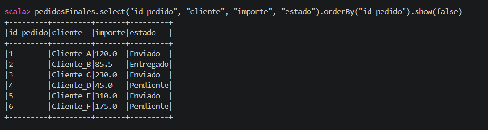

# Apache Hudi con Spark y Scala

Demostración de UPSERT, Time Travel y lectura incremental sobre una tabla de pedidos ficticios **Copy-on-Write**.

Práctica desarrollada como aportación individual a un trabajo académico en equipo del Máster en Business Intelligence y Big Data. Este repositorio recoge la demostración técnica; la memoria conjunta y la presentación del equipo quedan fuera de su alcance.

## El caso en un minuto

1. Crear cinco pedidos y almacenarlos en Hudi.
2. Actualizar los estados de los pedidos 1 y 2 e insertar el pedido 6 mediante UPSERT.
3. Consultar los dos commits y recuperar la versión inicial mediante Time Travel.
4. Obtener los pedidos 1, 2 y 6 con una lectura incremental.
5. Inspeccionar el plan de Spark y comprobar los resultados mediante `require` de Scala.



## Tecnologías

| Componente | Versión del entorno de trabajo |
|---|---|
| Apache Hudi | 1.1.1 |
| Apache Spark | 3.5.7 |
| Scala | 2.12.18 |
| Java | OpenJDK 17 |
| Sistema | Ubuntu 24.04 sobre WSL2 |
| Ejecución | `local[2]` |

## Estructura

```text
apache-hudi-spark-demo/
├── README.md
├── demo_hudi.scala
├── .gitignore
├── .gitattributes
└── evidencias/
    ├── 01_tabla_inicial.png
    ├── 02_tabla_despues_upsert.png
    ├── 03_historial_commits.png
    ├── 04_time_travel.png
    ├── 05_lectura_incremental.png
    └── 06_plan_ejecucion_incremental.png
```

El código Scala conserva las operaciones del paquete académico y las agrupa en un único bloque para que `:load` compile correctamente las cadenas multilínea. Si falla una operación o una aserción, no se alcanza el mensaje final de éxito. No se incluyen los datos generados, el JAR ni la memoria del equipo.

## Reproducir la demostración

Requisitos: Linux o WSL2, Java 17 y Spark 3.5.7 compilado para Scala 2.12. El ejecutable `spark-shell` debe estar en el `PATH`; alternativamente utiliza su ruta completa.

Desde la raíz de este repositorio:

```bash
mkdir -p jars
curl --fail --location \
  https://repo.maven.apache.org/maven2/org/apache/hudi/hudi-spark3.5-bundle_2.12/1.1.1/hudi-spark3.5-bundle_2.12-1.1.1.jar \
  --output jars/hudi-spark3.5-bundle_2.12-1.1.1.jar

spark-shell \
  --master 'local[2]' \
  --jars jars/hudi-spark3.5-bundle_2.12-1.1.1.jar \
  --conf spark.serializer=org.apache.spark.serializer.KryoSerializer \
  --conf spark.sql.catalog.spark_catalog=org.apache.spark.sql.hudi.catalog.HoodieCatalog \
  --conf spark.sql.extensions=org.apache.spark.sql.hudi.HoodieSparkSessionExtension \
  --conf spark.kryo.registrator=org.apache.spark.HoodieSparkKryoRegistrar
```

En el intérprete Scala:

```scala
:load demo_hudi.scala
```

Al terminar, salir con `:quit`. Comprueba que no haya excepciones ni errores de compilación: el intérprete puede continuar después de un error, de modo que un mensaje final por sí solo no acredita una ejecución correcta.

La tabla se genera en `datos/pedidos_hudi_demo/`, relativa al directorio desde el que se inicia Spark. **Cada ejecución utiliza `overwrite` y reinicia esa tabla de prueba.** Ejecuta el ejemplo desde una carpeta dedicada y con un catálogo que no tenga otra tabla llamada `pedidos_hudi_demo` apuntando a una ubicación distinta.

## Resultados de la práctica

| Comprobación | Resultado esperado |
|---|---:|
| Pedidos iniciales | 5 |
| Pedidos después del UPSERT | 6 |
| Pedidos en Time Travel | 5 |
| Pedidos devueltos por la lectura incremental | 3 |
| Commits de escritura | 2 |

Los estados finales comprobados son `1 → Enviado`, `2 → Entregado` y `6 → Pendiente`. El script incluye `require` para los recuentos y esos tres estados. Muestra las métricas del historial, pero no contiene aserciones específicas sobre los errores de escritura o el número de actualizaciones del commit.

La versión agrupada en un bloque se volvió a ejecutar el 1 de noviembre de 2026 en una carpeta aislada, con Spark 3.5.7, Scala 2.12.18, Java 17 y el JAR de Hudi 1.1.1. Se completaron las aserciones sin errores de compilación ni fallos de validación: 5 pedidos iniciales, 6 actuales, 3 incrementales y 2 commits. El historial mostró 2 actualizaciones y 0 errores. Esta ejecución no modifica el origen histórico de las capturas incluidas.

### Qué aprendí al interpretar las métricas

En el historial capturado, el segundo commit muestra seis registros escritos y dos actualizaciones, aunque el UPSERT recibe tres filas. Con Copy-on-Write pueden reescribirse archivos que también contienen registros sin cambios. Es una explicación coherente con esa cifra; atribuir cada escritura física exigiría analizar los archivos y las estadísticas detalladas.

### Lectura incremental

El ejemplo obtiene los identificadores del historial y utiliza el segundo commit como `hoodie.datasource.read.begin.instanttime`. Las capturas muestran las claves 1, 2 y 6. No debe trasladarse ese límite a otra versión sin comprobar su semántica: Hudi 1.x utiliza tiempos de finalización para el intervalo incremental. Una lectura incremental del estado más reciente de las claves modificadas tampoco equivale a un CDC con todas las imágenes intermedias.

## Evidencias

Las capturas documentan la ejecución académica anterior sobre `pedidos_hudi`; el script portable usa `pedidos_hudi_demo`. Los nombres de variables y los instantes visibles pueden diferir, aunque representan el mismo caso práctico. La primera imagen muestra el conjunto inicial recuperado con una consulta histórica. No se presentan como capturas de una nueva ejecución del script portable.

| Evidencia | Qué muestra |
|---|---|
| [01 Tabla inicial](evidencias/01_tabla_inicial.png) | Cinco pedidos con sus valores iniciales |
| [02 Después del UPSERT](evidencias/02_tabla_despues_upsert.png) | Seis pedidos y estados actualizados |
| [03 Historial](evidencias/03_historial_commits.png) | Dos commits y métricas de escritura |
| [04 Time Travel](evidencias/04_time_travel.png) | Estado anterior con cinco claves |
| [05 Incremental](evidencias/05_lectura_incremental.png) | Pedidos 1, 2 y 6 |
| [06 Plan de ejecución](evidencias/06_plan_ejecucion_incremental.png) | `HoodieIncrementalFileIndex` |

La última captura contiene la ruta local `/home/jorge/master_bigdata/apache_hudi/datos/pedidos_hudi`. Se conserva como evidencia original. Los datos comerciales utilizados son ficticios.

## Alcance y limitaciones

- Validación funcional con un conjunto pequeño; no es un benchmark ni una implementación de producción.
- `id_pedido` también se utiliza como `precombine`, por lo que no permite ordenar temporalmente distintas versiones de la misma clave. Un caso con eventos tardíos necesitaría un campo temporal y una política de fusión adecuada.
- Los importes utilizan `Double` por sencillez; para importes contables convendría un decimal con precisión definida.
- No se prueban concurrencia, fallos, borrados, MoR ni evolución de esquema.
- Time Travel y el consumo incremental dependen de la conservación de archivos y metadatos.
- El plan muestra el mecanismo de lectura, pero no cuantifica una mejora de rendimiento.

## Documentación oficial

- [Spark Quick Start de Hudi 1.1.1](https://hudi.apache.org/docs/1.1.1/quick-start-guide/)
- [Tipos de tabla y consulta](https://hudi.apache.org/docs/1.1.1/table_types/)
- [SQL Queries e intervalos incrementales](https://hudi.apache.org/docs/1.1.1/sql_queries/)
- [Timeline](https://hudi.apache.org/docs/1.1.1/timeline/)

## Licencia

Todavía no se ha elegido una licencia para el código de esta práctica. Publicar el repositorio no concede por sí mismo una licencia de reutilización. Apache Hudi y Apache Spark son proyectos independientes y conservan sus propias licencias.
